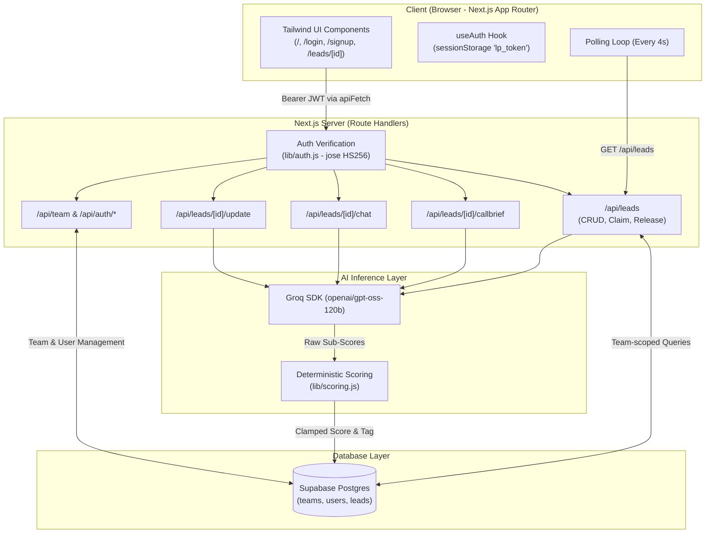

# Leed Lens — Real-Estate Lead Prioritizer

> **AI-ranked leads, so your sales team calls the right people first.**

Leed Lens is an intelligent lead qualification and prioritization platform engineered for real-estate sales teams. It transforms messy inbound inquiries (from WhatsApp, portals, and web forms) into scored, prioritized, and actionable deals with tailored briefing scripts, an on-demand AI sales coach, and a post-call re-scoring pipeline.

---

## Table of Contents

- [What We Built](#what-we-built)
- [Architecture Overview](#architecture-overview)
- [AI Model, APIs & Prompt Engineering](#ai-model-apis--prompt-engineering)
- [How to Run Locally](#how-to-run-locally)
- [Database Schema & Migrations](#database-schema--migrations)
- [Key Technical Decisions](#key-technical-decisions)
- [Known Limitations](#known-limitations)

---

## What We Built

Real-estate sales teams often suffer from **lead fatigue**: high inquiry volumes, inconsistent qualification, and wasted time calling lukewarm prospects while hot buyers go cold.

Leed Lens solves this by automating qualification, pre-call planning, and post-call analysis:

1. **Deterministic AI Qualification**:
   - Raw leads are evaluated across 4 objective rubric dimensions:
     - **Budget** (0–25)
     - **Timeline** (0–30)
     - **Requirement Clarity** (0–20)
     - **Buyer Engagement** (0–25)
   - Final scores (0–100) and priority tiers (**Hot** $\ge$ 70, **Warm** 40–69, **Cold** < 40) are computed deterministically in code.
2. **Instant Actionable Intelligence**:
   - Summarized customer intent, extracted property requirements, identified missing information, anticipated objections, and suggested immediate WhatsApp responses.
3. **Pre-Call Briefings & Distraction-Free Call Mode**:
   - One-click generated call brief containing a 20-second opening line, key call goal, what is already known, 3 specific discovery questions, and objection handling scripts.
   - Full-screen distraction-free Call Mode overlay with live keyboard shortcuts.
4. **Interactive AI Sales Coach**:
   - Lead-specific chat assistant powered by conversation history and qualification context to help formulate negotiation replies and handle buyer concerns.
5. **Post-Call Logging & Dynamic Re-Scoring**:
   - Paste raw call notes or transcripts to re-score the deal based on newly uncovered evidence, update timelines and budgets, and track an audit history of score changes.
6. **Lead Stats & Visual Analytics Suite**:
   - **Priority Matrix**: 2D scatter plot (Intent & Urgency vs. Budget & Fit) to target the high-priority quadrant immediately.
   - **Urgency Tracker**: Real-time speed-to-lead tracker categorizing aging leads (<2h, 2–24h, >24h).
   - **Inventory & Preference Match**: Aggregates customer demand (e.g., 2BHK vs 3BHK vs Villa) to spot inventory shortages.
   - **Pipeline Conversion Funnel**: Tracks drop-offs between inbound lead, claimed ownership, brief generated, and completed calls.
7. **Multi-Tenant Team Collaboration**:
   - Real multi-tenant teams with invite codes, owner/member roles, atomic lead claiming (preventing double-calling), and per-tab demo switching.

---

## Architecture Overview



### Architectural Principles
- **Server-Side Secret Isolation**: Secrets (`GROQ_API_KEY`, `SUPABASE_SERVICE_KEY`, `AUTH_SECRET`) are strictly accessed in server-only route handlers and never exposed to the client.
- **Privacy-First Inference**: Phone numbers and email addresses are filtered out and **never** transmitted to the LLM.
- **Stateless Authorization**: HS256 JWT tokens signed via `jose` verify user identity (`session.sub`) and enforce team boundaries (`session.team_id`) across all API routes.
- **Decoupled Scoring Engine**: The LLM outputs sub-score evidence; code computes the overall score and tag to guarantee consistency.

---

## AI Model, APIs & Prompt Engineering

### Model & Provider
- **Provider**: [Groq Cloud](https://groq.com/) using the `groq-sdk`.
- **Model**: `openai/gpt-oss-120b` running on Groq's LPU inference engine, delivering sub-second response times for complex structured JSON generation.

### Inference Pipeline Breakdown

| Task | Module | Temperature | Response Format | Description |
| :--- | :--- | :---: | :--- | :--- |
| **Lead Analysis** | [`lib/analyze.js`](file:///e:/projects/lead-prioritizer/lead-prioritizer/lib/analyze.js) | `0.2` | `json_object` | Analyzes buyer inquiry to extract requirements, missing info, objections, next actions, and 4 qualification sub-scores. |
| **Call Brief** | [`lib/callbrief.js`](file:///e:/projects/lead-prioritizer/lead-prioritizer/lib/callbrief.js) | `0.4` | `json_object` | Crafts call goal, 20-second opening line, 3 discovery questions with rationale, and rebuttal scripts. |
| **AI Sales Coach** | [`lib/chat.js`](file:///e:/projects/lead-prioritizer/lead-prioritizer/lib/chat.js) | `0.5` | Text (max 600 tokens) | Answers sales queries using lead context and the last 10 conversational turns. |
| **Post-Call Evaluation** | [`lib/postcall.js`](file:///e:/projects/lead-prioritizer/lead-prioritizer/lib/postcall.js) | `0.2` | `json_object` | Evaluates call notes against prior qualification state; shifts sub-scores only with evidence. |

### Prompt Design & Safety
- All prompt templates reside centrally in [`lib/prompts.js`](file:///e:/projects/lead-prioritizer/lead-prioritizer/lib/prompts.js).
- Prompts enforce strict real-estate heuristics:
  - Timeline scores prioritize immediate transactions ("Within 1 month" = 25–30 pts; "Just exploring" = 0–5 pts).
  - Explicit budget mentions with financing readiness receive higher budget scores.
  - The model is instructed to avoid assumptions: if an inquiry lacks budget or location details, it records them under `missing_info` and assigns low rubric points.
- Every structured output undergoes runtime validation. If parsing or schema validation fails, the service performs a single retry before returning a clean `502 Bad Gateway`. No canned or mock AI fallbacks exist.

---

## How to Run Locally

### Prerequisites
- Node.js 18.17+ or Node.js 20+
- A [Supabase](https://supabase.com/) project (PostgreSQL)
- A [Groq API Key](https://console.groq.com/)

### Step 1: Clone & Install Dependencies
```bash
git clone https://github.com/Yeshwanthsgowda/lead-prioritizer.git
cd lead-prioritizer
npm install
```

### Step 2: Configure Environment Variables
Create a `.env.local` file in the project root:

```env
# Groq API Key
GROQ_API_KEY=gsk_your_groq_api_key_here

# Supabase Configuration
SUPABASE_URL=https://your-project.supabase.co
SUPABASE_SERVICE_KEY=your_supabase_service_role_key_here

# Auth Secret (Minimum 32 characters)
AUTH_SECRET=your_super_secret_signing_key_at_least_32_chars_long
```

> [!IMPORTANT]
> `SUPABASE_SERVICE_KEY` must be the **service_role** key (not the anon key) because database queries run server-side and enforce multi-tenancy in application logic.

### Step 3: Run Database Migrations
Execute the SQL statements provided in the [Database Schema & Migrations](#database-schema--migrations) section in your Supabase SQL Editor.

### Step 4: Start the Development Server
```bash
npm run dev
```

Open [http://localhost:3000](http://localhost:3000) in your browser.

- You will be redirected to `/login`.
- Click **"Continue as Salesperson A"** or **"Continue as Salesperson B"** to test with pre-configured demo credentials.
- Open a second browser tab (or incognito window) with the other salesperson to test live atomic claiming and synchronization!
- Alternatively, click **"Create an account"** at `/signup` to set up a private team.

---

## Database Schema & Migrations

Run the following SQL in your Supabase SQL Editor to set up the multi-tenant architecture:

```sql
-- 1. Create teams table
create table if not exists teams (
  id uuid primary key default gen_random_uuid(),
  name text not null,
  is_demo boolean not null default false,
  invite_code text unique
);

-- 2. Create users table
create table if not exists users (
  id uuid primary key default gen_random_uuid(),
  name text not null,
  email text unique not null,
  password_hash text,
  role text not null check (role in ('owner', 'member')),
  team_id uuid not null references teams(id) on delete cascade,
  is_demo boolean not null default false
);

-- 3. Create leads table
create table if not exists leads (
  id uuid primary key default gen_random_uuid(),
  created_at timestamp with time zone default timezone('utc'::text, now()) not null,
  name text not null,
  phone text not null,
  email text,
  location text,
  property_requirement text,
  budget text,
  timeline text not null,
  message text not null,
  analysis jsonb,
  call_brief jsonb,
  chat jsonb default '[]'::jsonb,
  call_log jsonb default '[]'::jsonb,
  score integer,
  tag text,
  created_by uuid references users(id) on delete set null,
  claimed_by uuid references users(id) on delete set null,
  claimed_at timestamp with time zone,
  team_id uuid references teams(id) on delete cascade
);

-- 4. Create performance indexes
create index if not exists leads_team_id_idx on leads(team_id);
create index if not exists leads_score_idx on leads(score desc nulls last);
create index if not exists users_team_id_idx on users(team_id);
create index if not exists users_email_idx on users(email);
```

---

## Key Technical Decisions

### 1. Deterministic Scoring in Code vs. LLM Scoring
**Decision**: The LLM outputs granular sub-scores (0–25 for Budget, 0–30 for Timeline, etc.), while the composite score (0–100) and priority category (`Hot`, `Warm`, `Cold`) are calculated in pure code ([`lib/scoring.js`](file:///e:/projects/lead-prioritizer/lead-prioritizer/lib/scoring.js)).  
**Why**: LLMs are prone to arithmetic drift and threshold inconsistency. By delegating rubric evaluation to the model but keeping score compilation deterministic, priority thresholds remain mathematically stable.

### 2. Atomic Lead Claiming Without WebSockets
**Decision**: Lead claiming utilizes a single atomic SQL update:
```sql
UPDATE leads 
SET claimed_by = $userId, claimed_at = now() 
WHERE id = $leadId AND team_id = $teamId AND claimed_by IS NULL
```
**Why**: When two reps click "Claim" at the same instant, database-level locking guarantees only one succeeds. The second receives an HTTP 409 Conflict. This prevents race conditions without requiring stateful WebSockets or distributed locks.

### 3. Client Storage via `sessionStorage`
**Decision**: JWT tokens are stored in `sessionStorage` under `lp_token` rather than `localStorage`.  
**Why**: `sessionStorage` is tab-scoped. This allows a developer or demo viewer to open Salesperson A in Tab 1 and Salesperson B in Tab 2 simultaneously, testing claims and handoffs in real-time without session collisions.

### 4. Bounded Polling (4 Seconds)
**Decision**: The client polls `GET /api/leads` every 4 seconds, automatically skipping polls when `document.hidden` is true.  
**Why**: Provides sub-5-second sync across sales reps without the operational overhead, reconnection logic, or edge-case handling of persistent WebSocket connections.

### 5. Multi-Tenant Anti-Enumeration
**Decision**: Queries for leads belonging to other teams return an identical `404 Lead not found` rather than `403 Forbidden`.  
**Why**: Prevents malicious actors or competitor teams from probing or enumerating lead UUIDs across teams.

### 6. Zero-Bloat Stack
**Decision**: Plain JavaScript with native Tailwind CSS, vanilla Next.js App Router, and minimal libraries (`@supabase/supabase-js`, `groq-sdk`, `jose`, `bcryptjs`).  
**Why**: Eliminates dependency churn, heavy component bundle overhead, and complex compilation configurations, ensuring the code is maintainable and transparent.

---

## Known Limitations

- **Stateless Token Invalidation**: JWT sessions are stateless and valid for 12 hours. Logging out clears the token from client `sessionStorage`, but the token cannot be revoked server-side before expiration without a database token blocklist.
- **Polling Latency**: Updates made by one salesperson take up to 4 seconds to reflect on another salesperson's screen.
- **Single-Team Membership**: Users currently belong to exactly one team at a time; multi-organization switching under a single login is not supported.
- **Seed Throughput**: The demo reset route executes 6 sequential Groq analyses to respect per-minute rate limits, which requires 20–30 seconds to complete.
- **WhatsApp Web Integration**: The WhatsApp button deep-links to `https://wa.me/` with pre-filled AI responses, requiring an active WhatsApp client on the user's device rather than a direct server-to-server Business API gateway.
